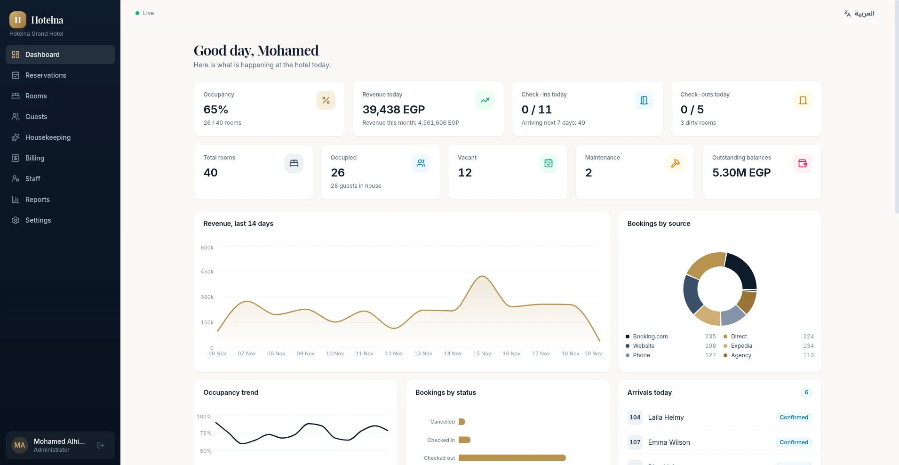
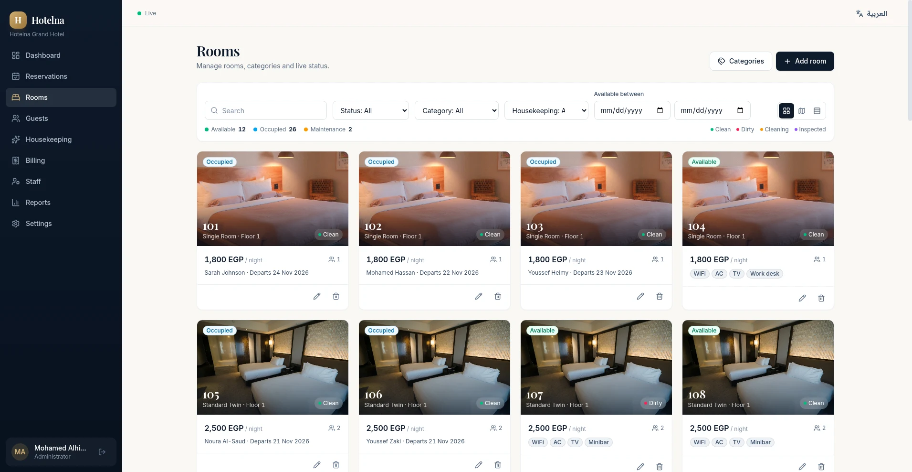
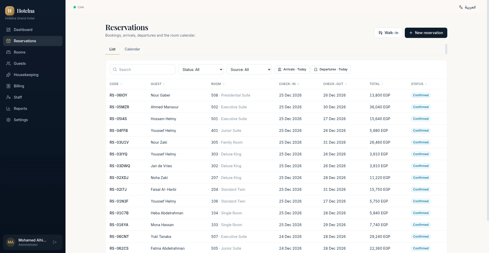
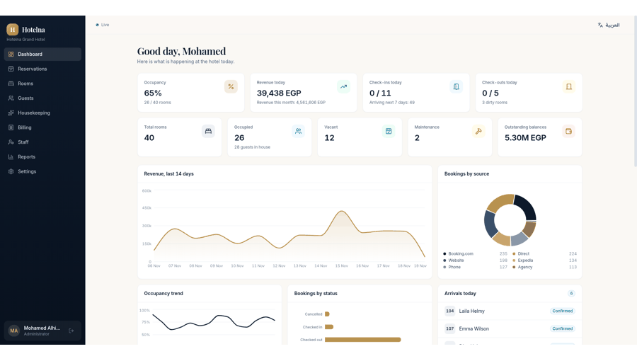
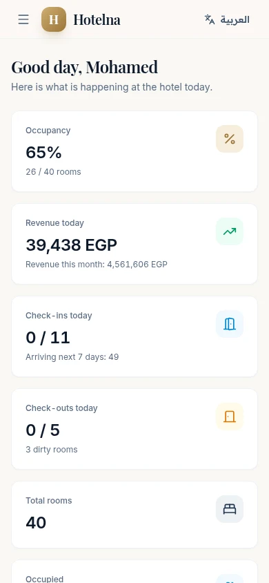

# Hotelna

[Open the live application](https://hotelna.pages.dev/)

## See it in action

Occupancy and revenue dashboard, room cards and reservation records.



| Rooms | Reservations |
| --- | --- |
|  |  |

### Short interface tour



A short GIF of three real navigation captures, not a continuous screen recording. Captured from the live site on November 19, 2026. The captures use the seeded fictional hotel data.

<details>
<summary>Mobile layout (390px)</summary>



</details>

A bilingual hotel property management application: dashboard, rooms, reservations (with drag-and-drop calendar), guest CRM, housekeeping and maintenance, billing, staff, reports (PDF and Excel export) and settings. Arabic (Egyptian) and English, with RTL support.

**Stack:** Next.js static export, React, TypeScript, Tailwind CSS, Hono on Cloudflare Pages Functions and Cloudflare D1 (SQLite). The application uses free-tier services, with provider quotas.

## Develop

```bash
npm ci
npx wrangler d1 migrations apply hotelna --local
node db/seed.mjs > db/seed.sql && npx wrangler d1 execute hotelna --local --file=db/seed.sql
npm run build && npm run preview     # http://localhost:8788
```

Demo accounts (seeded): `admin@hotelna.example` / `Admin@123`, and manager, front desk, housekeeping and accountant users shown on the sign-in page.

## Roles

`admin` (everything), `manager`, `front_desk`, `housekeeping`, `accountant`. Permissions live in `shared/perms.ts` and are enforced on every API route and in the UI.

## Deploy (Cloudflare Pages)

```bash
npx wrangler d1 create hotelna            # put the id in wrangler.toml
npx wrangler d1 migrations apply hotelna --remote
npx wrangler pages secret put JWT_SECRET
npx wrangler pages deploy out --project-name hotelna
```

The Next.js export is `out/`. Use that directory for Pages deployment; the legacy `npm run deploy` script still names `dist/`. Production migrations and seed application are operator steps, not part of a README update. Back up existing data before applying migrations.
